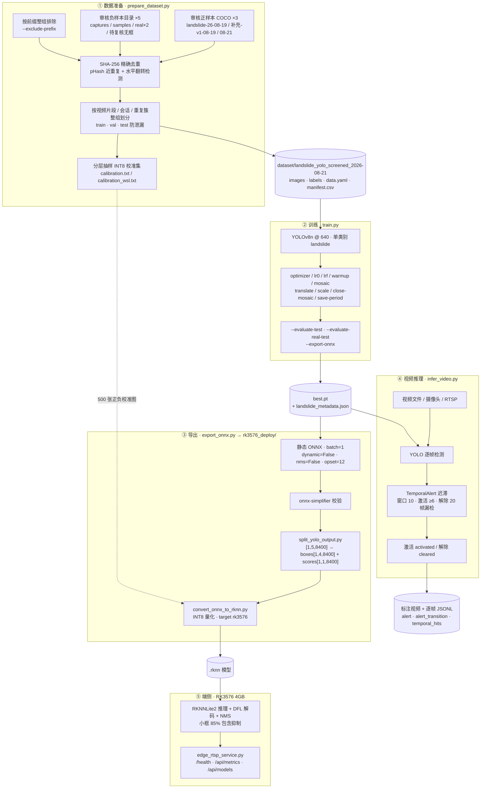

<div align="center">

# 🏔️ 滑坡检测 · Landslide Detect

**固定机位视频 → YOLOv8n 检测 → 10 帧时序迟滞（激活 / 解除）→ 事件告警与逐帧证据留档**
**静态 ONNX → RKNN INT8 → RK3576 4GB / 32GB 边端**

[](script_yolo/train.py)
[](script_yolo/infer_video.py)
[](rk3576_deploy/convert_onnx_to_rknn.py)
[](rk3576_deploy/)
[](script_yolo/requirements.txt)
[](#使用边界license)

</div>

> [!IMPORTANT]
> **本仓库只收代码、配置与文档。** 数据集（2.7GB 图片/标签）、模型权重（`*.pt` / `*.onnx` / `*.rknn`）、推理视频与训练产物**均不在仓库内**：`script_yolo/runs/`（88 个文件 / 809MB）被整目录排除，规则见 [`.gitignore`](.gitignore)。需要数据与权重时，按 [releases/landslide_20260828_rk3576/README.md](releases/landslide_20260828_rk3576/README.md) 自行准备或在内部发布包中获取。

---

## 这是什么

一套面向**固定摄像头滑坡监测**的完整算法工程：输入一路 1080P 视频（文件 / 摄像头 / RTSP），输出**目标框 + 事件级告警**；既能在一台带 GPU 的机器上完成数据融合、训练、导出与视频回放验证，也能把模型量化成 RKNN INT8 部署到 **Rockchip RK3576（4GB RAM / 32GB eMMC）** 边端。

它解决的不是"能不能检出滑坡"，而是**"零星的误检与漏检如何不变成误报与漏报"**：

| 问题 | 本工程的答案 |
|---|---|
| 单帧置信度抖动，偶发误检直接触发报警 | 检测结果进入 **`TemporalAlert` 迟滞状态机**：10 帧窗口内至少 6 帧检出才**激活**；激活后连续 20 帧无检出才**解除**，短暂漏检不会拆散同一次事件 |
| 正常路面、夜间灯光、隧道雾尘被误检 | 大量**无框负样本**（空标签）+ 模型驱动的**两轮动态难负样本重采样** + 按独立负样本视频标定 `--conf` |
| 静态图指标虚高：同一段视频跨 train/val/test | 从数据生成阶段就按视频片段 / 采集会话 / 近重复簇**整组划分**，并做 SHA-256 + pHash 去重 |
| 漏标、模糊、极端曝光的样本混进训练 | 正样本**质量只读审计** → 按风险类型**导出复核** → 按复核结论**清理重建** |
| 边端 4GB 内存、算力有限 | YOLOv8n + RKNN INT8，检测全交给 NPU，CPU 只承担解码、后处理与告警逻辑 |

更完整的"ByteTrack 短时关联 + 场景目标注册表 + 多证据事件状态机"设计见
[**滑坡跨帧检测与目标追踪方案.md**](滑坡跨帧检测与目标追踪方案.md)（v1.1 评估稿，含 RK3576 性能/内存预算与分阶段落地计划）。

---

## 核心特性（按代码实现整理）

### ① 数据准备：先把"数据泄漏"和"脏标签"这两条路堵死

- **多来源融合**：3 个审核过的 COCO 正样本源（`landslide-26-08-19`、`landslide补充-v1-08-19`、`landslide-08-21`）+ 5 个已审核负样本目录（`captures_v2_reviewed_negative`、`negative_samples`、`26-8-18-real`、`26_08_19-21-real`、`待复核-08-21-无框样本/images`）。`--reviewed-coco/--reviewed-images/--supplement-coco/--supplement-images/--new-coco/--new-images/--negative-dir`（可重复）均可自定义。
- **按前缀整组排除**：`--exclude-prefix`（默认 `landslide_3_`，可重复）把审核后不想要的整组文件直接标为 `excluded_user`，而不是删图。
- **两级去重**：全来源做 **SHA-256 精确去重**（保留优先级 `new_positive_20260821` > `supplement` > `reviewed`）；仅对审核公开数据做 **pHash 近重复去重**（同时比较原图与水平翻转，汉明距离阈值默认 4，`--phash-threshold 0` 关闭），并用**并查集**把近重复图聚成簇。
- **防泄漏划分**：从文件名/时间戳还原**视频片段、采集会话、连续帧序列**（如 `*.mp4_<秒>.<帧>`、`vlcsnap-<日期>-<hh>h<mm>m<ss>s`、`<前缀>_<4位帧号>.jpg`、`(video)frame_*` 等），按场景整组分配到 train/val/test，近重复簇也不会被拆散。
- **负样本用空 `.txt`**（Ultralytics 标准做法）；正样本目录里"没有框"的图片会被**隔离并记录**，不会自动改判成负样本。
- **INT8 校准集分层抽样**：默认从 train 按正负比例抽取（`--calibration-size`、`--calibration-positive-ratio`），同时产出本机绝对路径的 `calibration.txt` 与 `/mnt/<drive>/...` + 强制 LF 的 `calibration_wsl.txt`，可直接喂给 WSL 里的 RKNN-Toolkit2。
- **可审计产物**：`manifest.csv`（每张图的来源/分组/划分/SHA-256/状态）、`duplicates.csv`、`summary.json`（含 `source_split_counts`）、`annotations/instances_{train,val,test}.json`；`--dry-run` 先看统计、`--overwrite` 显式重建、`--copy-mode hardlink` 省磁盘。默认输出 `dataset/landslide_yolo_screened_2026-08-21`。
- **独立校验**：`validate_dataset.py` 校验图片/标签配对、YOLO 坐标范围与边界、class id、**跨划分 SHA-256 重复**、以及 `manifest.csv` 里的**分组泄漏**；CSV 兼容 `utf-8-sig` / `gb18030` 编码，有错即 `exit 1`。
- **质量治理闭环**：`audit_positive_quality.py` 只读审计并输出 `positive_quality_audit.csv`；`export_quality_review.py` 按风险类型（竖屏域差异、低分辨率、疑似模糊、极端曝光、目标过小、框贴边等）导出待复核图片与 `review_index.csv`；`clean_dataset_from_review.py` 按 `keep/review/exclude` 结论清理后重建，原始数据不被改写。
- **夜间难负样本增强**：`augment_night_negatives.py` 用 gamma（1.35–2.10）+ 曝光（0.55–0.85）+ 暖色通道增益模拟低照度路灯场景，75% 概率叠加高斯噪声、35% 概率轻度模糊，输出无标签负样本。

### ② 训练：参数全暴露，冒烟到正式训练同一条命令

- 单类别 `landslide`，`YOLOv8n @ 640`；默认 `--epochs 150`、`--batch 2`、`--patience 30`、`--seed 42`，训练侧固定 `deterministic=True / cos_lr / pretrained / plots / val`。
- **完整超参可调**：`--optimizer`（默认 `auto`）、`--lr0`、`--lrf`、`--warmup-epochs`、`--mosaic`、`--translate`、`--scale`、`--close-mosaic`、`--save-period`，全部透传给 Ultralytics 并写进 `landslide_metadata.json`。
- **三种评估口径**：`--evaluate-test` 跑完整 test；`--evaluate-real-test <data.yaml>` 额外在**纯真实 test 子集**上单独报告（不掺合成图）；两者结果都落到 metadata，避免反复用 test 调参。
- **训练即导出**：`--export-onnx` 在训练结束后直接产出部署用静态 ONNX。
- `--fraction`（如 0.01 冒烟）、`--cache ram|disk`、`--resume`、`--workers`、`--device 0,1|cpu` 齐备；默认 `--data dataset/landslide_yolo_screened_2026-08-21/data.yaml`、默认 run 名 `landslide_yolov8n_screened_2026-08-21`。
- 选型结论：**瓶颈在数据与决策层，不在检测器**，因此沿用 nano 级模型，把算力留给后处理与告警。

### ③ 导出：给 RKNN-Toolkit2 准备"静态、单 batch、无 NMS"的模型

- `export_onnx.py` 导出 `batch=1`、`dynamic=False`、`nms=False`、默认 `opset=12` 的静态 ONNX；
- `export_utils.py` 再用 **onnx-simplifier** 简化并校验（校验失败直接抛错），保证转换器拿到干净的图；
- 端侧先 `split_yolo_output.py` 把单输出 `[1,5,8400]` 拆成 `boxes [1,4,8400]` + `scores [1,1,8400]`（避免坐标与分数共用 INT8 scale），再转 RKNN。

### ④ 视频推理：纯检测 + 时序迟滞（`TemporalAlert`）

主推理链路**只使用 YOLO 检测结果**，不再引入帧差/光流判定。`infer_video.py` 把每帧"是否有检出"喂给一个显式的迟滞状态机：

```text
votes = deque(maxlen=window)          # window 默认 10
update(detected):
    未激活: 窗口未填满 → 不动作
            窗口已填满且 hits >= activate_hits → 激活, 返回 "activated"
    已激活: detected 则 miss_streak 清零，否则 +1
            miss_streak >= clear_misses → 解除, 返回 "cleared"
            （其余情况保持激活，短暂漏检不会抖动）
```

- 默认 `--alert-window 10 --alert-min-hits 6 --alert-clear-misses 20`：10 帧窗口内 ≥6 帧检出才激活；报警后连续 20 帧无检出才解除。25 FPS 下窗口约 0.4 秒、解除延迟约 0.8 秒，**板端跳帧时必须按实际推理 FPS 换算**。
- 每帧写一行 **JSONL**：帧号、时间戳、检测框与置信度、`detection_count`、`temporal_hits`、`temporal_window_filled`、`alert`、`alert_transition`（`activated` / `cleared`）。
- 输出**标注视频**（告警期间红框 + `LANDSLIDE ALERT`，并显示 `detections=hits/window`）；结束时打印 `detection_frames / alert_frames / alert_activations / alert_clears / alert_rule` 汇总。
- `--conf`（默认 0.35）必须用**独立真实负样本视频**标定；`--iou`、`--imgsz`、`--device`、`--max-frames`、`--no-video`、`--view`、`--events/--output/--runs-dir` 均可调。
- `motion.py`（相机补偿帧差 + 稀疏光流）与 `test_motion.py` 是**早期实验模块**，仅用于复现历史实验，当前 `infer_video.py` 不引用它们（详见 [script_yolo/README.md](script_yolo/README.md) 第 3 节）。

<details>
<summary>时序与阈值调参建议（点击展开）</summary>

| 参数 | 默认 | 作用 |
|---|---:|---|
| `--conf` | 0.35 | 单帧检测阈值；用独立真实负样本回放标定，不要用 test 集刷 |
| `--alert-window` | 10 | 迟滞窗口帧数；25 FPS 约 0.4 秒 |
| `--alert-min-hits` | 6 | 窗口内激活所需命中帧数（必须 ≤ window） |
| `--alert-clear-misses` | 20 | 激活后解除所需连续漏检帧数（25 FPS 约 0.8 秒） |
| `--iou` / `--imgsz` | 0.6 / 640 | NMS 与推理尺寸 |

调参顺序：① 先按实际推理 FPS 定 `alert-window` / `alert-clear-misses`，明确首报延迟目标；② 用独立负样本视频定 `conf`，再看召回；③ 报警抖动优先加大 `alert-clear-misses`，漏报优先检查数据与 `conf`，不要靠调窗口掩盖检测质量问题。

</details>

### ⑤ 端侧：RK3576 上把 NPU 用起来，把 CPU 省下来

- RKNN-Toolkit2 / RKNN-Toolkit-Lite2 / `librknnrt.so` 统一 **2.3.2**，目标平台 `rk3576`；INT8 为部署精度，FP16 仅作精度对照。
- `infer_rknn.py` 支持单输出与 Rockchip 优化模型的 6/9 输出两种 head，打印预处理 / NPU 推理 / 后处理**分段耗时**；后处理除 IoU 外增加"**小框 85% 被大框包含则抑制**"，专治大框套小框的重复而不过度合并。
- `benchmark_rknn.py` 只测 `runtime.inference()`（预热 10 次，可对比 `auto/core0/core1/both` 核心掩码），排除前后处理干扰。
- `edge_rtsp_service.py` 是板端常驻服务（配 `landslide-edge-stream.service`），提供 `/health`、`/api/metrics`、`/api/models` 等接口；`stream_lab/` 是 Windows 侧实时实验台：上传视频循环推 RTSP → 板端检测 → 推回 → 网页 HLS 播放并轮询指标。
- 注：`script_yolo/README.md` 的部署边界段落沿用以 RK3568 为基线的历史表述，实际板端主线在 [`rk3576_deploy/`](rk3576_deploy/README.md)（RK3576）。

---

## 架构与数据流



---

## 目录结构

```text
landslide-detect/
├── README.md                          # 本文件
├── .gitignore                         # 权重/数据/视频/runs 的排除规则
├── 滑坡跨帧检测与目标追踪方案.md        # 技术方案 v1.1：多证据源、事件状态机、RK3576 预算与阶段计划
│
├── script_yolo/                       # ★ 算法主线：数据治理 → 训练 → 导出 → 视频推理
│   ├── prepare_dataset.py             # 3 正样本源 + 5 负样本目录 → YOLO 数据集（去重/防泄漏/校准集/审计产物）
│   ├── validate_dataset.py            # 数据集校验：配对、坐标、跨划分重复、分组泄漏
│   ├── audit_positive_quality.py      # 正样本质量只读审计（输出 CSV，不改数据）
│   ├── export_quality_review.py       # 按风险类型导出待复核图片与索引
│   ├── clean_dataset_from_review.py   # 按复核结论清理数据后重建
│   ├── augment_night_negatives.py     # 夜间路灯/低照度难负样本合成
│   ├── build_gpt_augmented_dataset.py # GPT 审计后的增强数据集构建
│   ├── build_domain_balanced_train_list.py        # 域平衡训练清单生成
│   ├── integrate_seedance_annotations.py          # Seedance 标注入库
│   ├── integrate_seedance_review_frames.py        # Seedance 复核帧入库
│   ├── train.py                       # YOLOv8n 训练入口（完整超参 + test/real-test + 可选 ONNX 导出）
│   ├── export_onnx.py                 # 导出 batch=1 静态 ONNX 供 RKNN 转换
│   ├── export_utils.py                # ONNX 导出 + onnx-simplifier 校验共享实现
│   ├── mine_hard_negatives.py         # 模型驱动的两轮动态难负样本重采样（非 loss 层 OHEM）
│   ├── evaluate_positive_subset.py    # 正样本子集评估
│   ├── evaluate_negative_subset.py    # 负样本子集误报评估
│   ├── evaluate_landslide_checkpoints.py          # 多 checkpoint 对比评估
│   ├── compare_regression_reports.py  # 新旧模型回归报告对比
│   ├── infer_video.py                 # 视频/RTSP 推理：YOLO + TemporalAlert 迟滞 + JSONL + 标注视频
│   ├── motion.py                      # 早期实验：相机补偿帧差 + 稀疏光流残差（当前链路不引用）
│   ├── test_infer_video.py            # TemporalAlert 单元测试（激活/不误激活/迟滞保持/解除）
│   ├── test_motion.py                 # 运动分析单元测试（早期实验模块）
│   ├── test_prepare_dataset.py        # 校准集抽样单元测试
│   ├── test_validate_dataset.py       # 数据根目录解析测试（pytest）
│   ├── test_build_gpt_augmented_dataset.py        # 增强数据集构建测试
│   ├── requirements.txt               # 依赖（ultralytics / opencv-headless / ImageHash / onnx）
│   ├── README.md                      # 数据融合、训练、推理与 RK 部署边界的详细说明
│   └── run_train_*.sh                 # 各轮训练/评估复现脚本（参数与当前 train.py 对齐）
│
├── dataset/                           # 只入库 data*.yaml 与说明文档，图片/标签/标注不入库
│   ├── landslide_yolo_gpt_clean_2026-08-26/   # 最新训练数据配置（data*.yaml + PACKAGE_README.md）
│   ├── landslide_yolo_screened_2026-08-19|21/ # 早期筛选数据配置（prepare_dataset 默认输出 08-21）
│   ├── 待复核-08-21-无框样本/           # 无框样本复核说明
│   └── 待标注-正样本-seedance-2026-08-27/     # Seedance 正样本待标注说明
│
├── rk3576_deploy/                     # ★ RK3576 端侧：转换、推理、基准、常驻服务
│   ├── convert_onnx_to_rknn.py        # ONNX → RKNN（INT8/FP16）
│   ├── split_yolo_output.py           # 拆分 YOLOv8 单输出头
│   ├── infer_rknn.py                  # RKNNLite2 推理（图片/视频/RTSP，分段耗时）
│   ├── runtime_utils.py               # RKNN runtime 创建与核心绑定
│   ├── benchmark_rknn.py              # 纯 inference 性能基准（多核心掩码）
│   ├── edge_rtsp_service.py           # 板端 RTSP 推理 worker + 监控/控制 API
│   ├── landslide-edge-stream.service   # systemd 单元
│   ├── calibration_500.txt            # 500 张校准清单
│   ├── requirements-board.txt         # 板端依赖
│   ├── test_rk3576_deploy.py          # 无需板卡的单元测试
│   └── stream_lab/                    # 本机 RTSP 推流 + Web 控制台 + HLS 预览
│
├── releases/landslide_20260828_rk3576/ # 发布说明、模型选择报告、数据统计、SHA256SUMS（二进制不入库）
└── test_real/                         # 真实场景测试截图
```

> **历史说明**：本仓库 `script_yolo/` 以 **2026-08-28 的服务端主线**为准；本地 SVN 工作副本另有一份 **2026-07-27** 的早期实现（以 `motion.py` 运动门控为推理主线），仅作历史参考，未纳入本仓库（仓库内的 `motion.py` 只是历史实验模块，当前链路不引用）。

---

## 快速开始

### 0. 环境

```bash
# 数据整理 / 训练 / 导出 / 视频推理（Python 3.10+）
pip install -r script_yolo/requirements.txt
```

主要依赖：`ultralytics==8.4.89`、`opencv-python-headless==4.10.0.84`、`Pillow`、`ImageHash==4.3.2`、`PyYAML`、`onnx`、`onnx-simplifier`。仓库内的示例命令按 conda 环境书写（如 `conda run -n yolo-obb python ...`），按本机环境替换即可——**没有 PyTorch/ultralytics 的环境不能用于训练**。

### 1. 数据准备

`prepare_dataset.py` 的默认输入指向原始工程布局（`dataset/正样本-滑坡/...`、`dataset/负样本-滑坡/...`，**数据本体不入库**），请用自己的目录或显式参数：

```bash
# 只看统计、不写盘
python script_yolo/prepare_dataset.py --dry-run

# 生成数据集 + 500 张正负各半的 INT8 校准集（默认输出 dataset/landslide_yolo_screened_2026-08-21）
python script_yolo/prepare_dataset.py \
  --reviewed-coco    /path/to/landslide-26-08-19/annotations/instances_Train.json \
  --reviewed-images  /path/to/landslide-26-08-19/images/Train \
  --supplement-coco  /path/to/landslide补充-v1-08-19/annotations/instances_Train.json \
  --supplement-images /path/to/landslide补充-v1-08-19/images/Train \
  --new-coco         /path/to/landslide-08-21/annotations/instances_Validation.json \
  --new-images       /path/to/landslide-08-21/images/Validation \
  --negative-dir     /path/to/captures_v2_reviewed_negative \
  --negative-dir     /path/to/negative_samples \
  --exclude-prefix   landslide_3_ \
  --calibration-size 500 --calibration-positive-ratio 0.5

# 结构与泄漏校验（有错 exit 1）
python script_yolo/validate_dataset.py --data dataset/landslide_yolo_screened_2026-08-21/data.yaml
```

需要重建时加 `--overwrite`；省磁盘可用 `--copy-mode hardlink`。质量治理（只读审计 → 导出复核 → 清理重建）：

```bash
python script_yolo/audit_positive_quality.py --data-dir dataset/landslide_yolo_screened_2026-08-21
python script_yolo/export_quality_review.py --audit dataset/landslide_yolo_screened_2026-08-21/positive_quality_audit.csv
```

夜间难负样本可另行合成：

```bash
python script_yolo/augment_night_negatives.py \
  --input-dir dataset/landslide_yolo_screened_2026-08-21/images/train \
  --output-dir dataset/night_neg --max-images 300 --copies 2
```

### 2. 训练

`train.py` 默认读 `dataset/landslide_yolo_screened_2026-08-21/data.yaml`。下面这条命令与 `script_yolo/run_train_gpt_clean_20260826.sh` 一致，覆盖完整超参、test 评估、真实 test 评估与 ONNX 导出：

```bash
python script_yolo/train.py \
  --data dataset/landslide_yolo_gpt_clean_2026-08-26/data_domain_balanced.yaml \
  --model yolov8n.pt \
  --epochs 100 --imgsz 640 --batch 1 --workers 4 --patience 20 --device 0 \
  --optimizer AdamW --lr0 0.0005 --lrf 0.1 --warmup-epochs 1 \
  --mosaic 0.2 --translate 0.05 --scale 0.25 --close-mosaic 10 --save-period 5 \
  --name landslide_yolov8n_gpt_clean_2026-08-26 \
  --evaluate-test \
  --evaluate-real-test dataset/landslide_yolo_gpt_clean_2026-08-26/data_real_test.yaml \
  --export-onnx
```

- 显存不足把 `--batch` 降到 1；产物写入 `script_yolo/runs/train/<name>/`（已 git 忽略），超参与指标写入 `landslide_metadata.json`。
- 部署阈值应按**召回率**而不是只看 mAP 选；超参最终确定后再开 `--evaluate-test` / `--evaluate-real-test`，不要反复用 test 调参。
- 数据 YAML 里的 `path:` 是原始工作站的绝对路径，迁移后需修改；`data_portable.yaml` 不写固定根目录。
- 其余各轮实验命令见 `script_yolo/run_train_*.sh`。

### 3. 导出 ONNX / RKNN

```bash
# 静态 ONNX（batch=1、dynamic=False、nms=False、opset=12）
python script_yolo/export_onnx.py \
  --model script_yolo/runs/train/landslide_yolov8n/weights/best.pt \
  --imgsz 640 --opset 12

# 拆输出头 → INT8 量化（在装好 RKNN-Toolkit2 2.3.2 的 x86 主机上）
python rk3576_deploy/split_yolo_output.py \
  --source best.onnx --output landslide_split.onnx
python rk3576_deploy/convert_onnx_to_rknn.py \
  --onnx landslide_split.onnx \
  --output landslide_int8_rk3576.rknn \
  --precision int8 \
  --dataset calibration.txt
```

### 4. 视频推理

```bash
python script_yolo/infer_video.py \
  --model script_yolo/runs/train/landslide_yolov8n/weights/best.pt \
  --source /path/to/video.mp4 \
  --conf 0.35 --device 0 \
  --alert-window 10 --alert-min-hits 6 --alert-clear-misses 20
```

默认输出 `script_yolo/runs/infer/<stem>_annotated.mp4` 与同名 `.jsonl`；`--no-video` 只出 JSONL，`--max-frames` 便于冒烟测试，`--view` 实时预览，`--source` 支持视频路径、摄像头编号与 `rtsp://`。纯 CPU 冒烟：`--device cpu --max-frames 60`。

### 5. 端侧（RK3576）

```bash
# 板端：图片 / 视频 / RTSP 推理
python rk3576_deploy/infer_rknn.py \
  --model model.rknn --source test.mp4 --output result.mp4 \
  --imgsz 640 --conf 0.35 --iou 0.5 --cores auto

# 纯 NPU 性能基准（预热 10 次，对比 4 种核心掩码）
python rk3576_deploy/benchmark_rknn.py \
  --model model.rknn --warmup 10 --runs 100 --cores auto,core0,core1,both
```

版本必须对齐：**RKNN-Toolkit2 / RKNN-Toolkit-Lite2 / `librknnrt.so` 同为 2.3.2**，否则模型可能无法加载。完整步骤（校准清单、scp 部署、systemd 服务、核心频率检查）见 [rk3576_deploy/README.md](rk3576_deploy/README.md)。

---

## 关键脚本

| 脚本 | 一句话职责 |
|---|---|
| [`script_yolo/prepare_dataset.py`](script_yolo/prepare_dataset.py) | 3 正样本源 + 5 负样本目录 → YOLO 数据集，含两级去重、整组划分、前缀排除、校准集与审计 CSV |
| [`script_yolo/validate_dataset.py`](script_yolo/validate_dataset.py) | 校验图片/标签配对、坐标合法性、跨划分重复与分组泄漏，有错退出码 1 |
| [`script_yolo/audit_positive_quality.py`](script_yolo/audit_positive_quality.py) | 正样本质量只读审计，输出 `positive_quality_audit.csv` |
| [`script_yolo/export_quality_review.py`](script_yolo/export_quality_review.py) | 按风险类型导出待复核图片与索引，不改原始数据 |
| [`script_yolo/clean_dataset_from_review.py`](script_yolo/clean_dataset_from_review.py) | 按复核结论清理并重建数据集 |
| [`script_yolo/augment_night_negatives.py`](script_yolo/augment_night_negatives.py) | gamma/曝光/色温/噪声/模糊合成夜间无框难负样本 |
| [`script_yolo/train.py`](script_yolo/train.py) | YOLOv8n 训练入口：完整超参 + test/real-test 双评估 + 可选 ONNX 导出 |
| [`script_yolo/mine_hard_negatives.py`](script_yolo/mine_hard_negatives.py) | 模型驱动两轮动态难负样本重采样（重复路径增曝，不复制图片） |
| [`script_yolo/evaluate_*.py`](script_yolo/evaluate_negative_subset.py) | 正/负子集、真实 test、多 checkpoint 对比评估 |
| [`script_yolo/compare_regression_reports.py`](script_yolo/compare_regression_reports.py) | 新旧模型回归报告对比 |
| [`script_yolo/export_onnx.py`](script_yolo/export_onnx.py) | 导出 batch=1 静态无 NMS ONNX，并做 onnx-simplifier 校验 |
| [`script_yolo/export_utils.py`](script_yolo/export_utils.py) | 上者复用的导出/简化实现 |
| [`script_yolo/infer_video.py`](script_yolo/infer_video.py) | 视频/RTSP 推理：YOLO 检测 + `TemporalAlert` 迟滞，输出标注视频与逐帧 JSONL |
| [`script_yolo/motion.py`](script_yolo/motion.py) | 早期实验：相机补偿帧差 + 稀疏光流残差（当前推理链路不引用） |
| [`script_yolo/test_infer_video.py`](script_yolo/test_infer_video.py) | TemporalAlert 单元测试（激活/短脉冲不误激活/迟滞保持/解除） |
| [`script_yolo/run_train_*.sh`](script_yolo/run_train_gpt_clean_20260826.sh) | 各轮训练/评估复现脚本，参数与当前 `train.py` 对齐 |
| [`rk3576_deploy/split_yolo_output.py`](rk3576_deploy/split_yolo_output.py) | 把 `[1,5,8400]` 单输出拆成 boxes/scores 两个输出，避免 INT8 共用 scale |
| [`rk3576_deploy/convert_onnx_to_rknn.py`](rk3576_deploy/convert_onnx_to_rknn.py) | ONNX → RKNN（INT8/FP16，2.3.2 / rk3576） |
| [`rk3576_deploy/infer_rknn.py`](rk3576_deploy/infer_rknn.py) | RKNNLite2 图片/视频/RTSP 推理，打印分段耗时 |
| [`rk3576_deploy/benchmark_rknn.py`](rk3576_deploy/benchmark_rknn.py) | 纯 `runtime.inference()` 性能基准 |
| [`rk3576_deploy/edge_rtsp_service.py`](rk3576_deploy/edge_rtsp_service.py) | 板端常驻 RTSP 推理服务 + 监控/模型切换 API |

---

## 参考指标与数据统计（摘自仓库内报告）

> 以下数字来自原始工作站 2026-08-27 / 2026-08-28 发布轮次，出处已标注；仓库不含对应权重与数据。

数据集划分（出处：[releases/landslide_20260828_rk3576/DATASET_SUMMARY.json](releases/landslide_20260828_rk3576/DATASET_SUMMARY.json)、[PACKAGE_README.md](dataset/landslide_yolo_gpt_clean_2026-08-26/PACKAGE_README.md)）：

| 划分 | 图片 | 正样本 | 负样本 | 框 |
|---|---:|---:|---:|---:|
| train | 2620 | 1465 | 1155 | 1488 |
| val | 314 | 185 | 129 | 188 |
| test | 285 | 156 | 129 | 159 |

模型指标（出处：[MODEL_SELECTION_REPORT.md](releases/landslide_20260828_rk3576/MODEL_SELECTION_REPORT.md)）：

| 评估集 | 模型 | Precision | Recall | mAP50 | mAP50-95 |
|---|---|---:|---:|---:|---:|
| 真实 test（260 张 / 134 框） | 上一候选 | 0.779 | 0.739 | 0.759 | 0.367 |
| 真实 test（260 张 / 134 框） | 本轮选择 | **0.811** | **0.754** | **0.760** | 0.362 |
| 完整 test（285 张 / 159 框） | 上一候选 | 0.825 | 0.723 | 0.795 | 0.407 |
| 完整 test（285 张 / 159 框） | 本轮选择 | **0.831** | **0.774** | 0.793 | 0.399 |

同一报告中的**场景回放**：在该轮已进入训练数据的 Seedance 场景上，`conf=0.35` 时正常段误报由 68/73 帧降到 0/73 帧，明显滑动段检出 52/79 帧，首次报警相对人工标注起点延迟约 0.68 秒；报警规则即本文的"10 帧 ≥6 帧激活、连续 20 帧漏检解除"，全视频只激活一次。报告同时声明该视频不能作为独立泛化证据。

---

## 文档索引

| 文档 | 内容 |
|---|---|
| [script_yolo/README.md](script_yolo/README.md) | 数据融合、训练、视频推理与 RK 部署边界的详细说明（含原始工程布局下的命令） |
| [滑坡跨帧检测与目标追踪方案.md](滑坡跨帧检测与目标追踪方案.md) | 技术方案 v1.1：问题定义、三路证据源、事件/摄像头状态机、RK3576 性能与内存预算、阶段计划、待决策点 |
| [rk3576_deploy/README.md](rk3576_deploy/README.md) | RKNN 转换、板端环境、性能基准、图片/视频/RTSP 推理 |
| [rk3576_deploy/stream_lab/README.md](rk3576_deploy/stream_lab/README.md) | 本机 RTSP 推流 + Web 控制台 + HLS 预览实验台 |
| [releases/landslide_20260828_rk3576/README.md](releases/landslide_20260828_rk3576/README.md) | 发布包说明：数据版本、模型版本、RKNN 转换与校验 |
| [releases/landslide_20260828_rk3576/MODEL_SELECTION_REPORT.md](releases/landslide_20260828_rk3576/MODEL_SELECTION_REPORT.md) | 模型选择报告：数据变更、两轮难负样本、指标、场景回放与边界 |
| [dataset/landslide_yolo_gpt_clean_2026-08-26/PACKAGE_README.md](dataset/landslide_yolo_gpt_clean_2026-08-26/PACKAGE_README.md) | 数据集发布说明：统计、迁移后训练、RKNN 校准清单生成 |
| [dataset/待复核-08-21-无框样本/README.md](dataset/待复核-08-21-无框样本/README.md) | 无框样本复核规则（negative / exclude / positive_missing_box） |
| [dataset/待标注-正样本-seedance-2026-08-27/README.md](dataset/待标注-正样本-seedance-2026-08-27/README.md) | Seedance 正样本标注要求（必须归入 train） |

---

## 已知限制

1. **仓库不含数据、权重与视频**：`*.pt` / `*.onnx` / `*.rknn`、数据集压缩包、推理与演示视频均被 [`.gitignore`](.gitignore) 排除，需自行准备或从内部发布包获取。
2. **只有"检测 + 时序迟滞"，没有身份级追踪**：当前没有目标 ID 关联、跨昼夜身份延续或事件状态机。ByteTrack 短时关联、场景目标注册表、长基线蠕变与事件状态机见[方案文档](滑坡跨帧检测与目标追踪方案.md)第 3、8 节，尚未实现。
3. **静态图/离线回放指标 ≠ 在线误报率**：报告中的 Precision/Recall 来自固定 test 集与已进入训练的场景回放，真实连续视频的报警率仍需独立负样本视频验证（见 MODEL_SELECTION_REPORT 的「边界」一节）。
4. **迟滞只解决时序抖动**：`TemporalAlert` 不理解目标身份、不区分"同一目标持续"与"不同位置轮流检出"，误检/漏检的根因仍在检测器与 `--conf`。
5. **硬解未验证**：板端用 `cv2.VideoCapture` + FFmpeg 取流，是否走 RK3576 MPP 硬解取决于板载 FFmpeg 是否编译 rkmpp，需实测；1080P 软解可能占满多核。
6. **4GB 内存是硬约束**：全链路峰值目标 <3GB，禁止大缓存；长稳运行需 72h 内存增长与 NPU 降频验证。
7. **INT8 有精度偏移**：量化后置信度可能整体平移，需用同一批图片对比 PT / ONNX / RKNN 的框与分数后重定阈值。
8. **路径会"绑机器"**：数据 YAML 与 `run_train_*.sh` 里保留了原始工作站绝对路径，迁移后需按新目录修改。
9. **数据合规**：网络补充素材仅用于内部研究训练，不商用，保留溯源；详见方案文档风险表。

## 使用边界（License）

本仓库**未附带开源许可证**，代码与文档默认仅限内部研究、评估与演示使用，不构成任何商用授权；网络视频素材仅用于内部训练且保留溯源。对外使用或再分发前请先确认授权与合规。

---

<div align="center">

**YOLOv8n + 时序迟滞** · 训练在 GPU 上，检测在 NPU 上，判断在时间轴上

</div>
