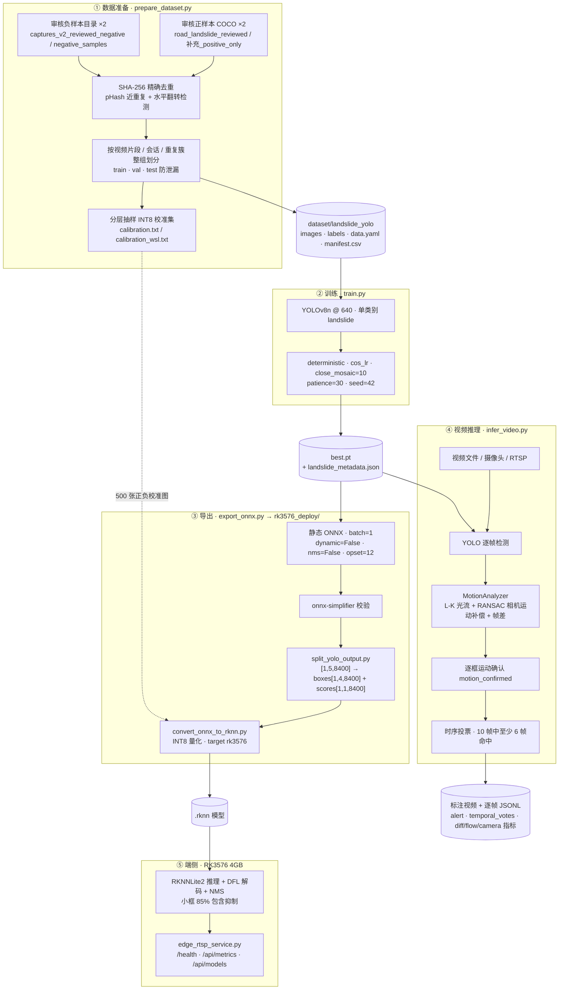

<div align="center">

# 🏔️ 滑坡检测 · Landslide Detect

**固定机位视频 → YOLOv8n 检测 → 相机运动补偿的门控 → 跨帧时序投票 → 告警与证据留档**
**静态 ONNX → RKNN INT8 → RK3576 4GB / 32GB 边端**

[](script_yolo/train.py)
[](script_yolo/infer_video.py)
[](rk3576_deploy/convert_onnx_to_rknn.py)
[](rk3576_deploy/)
[](script_yolo/requirements.txt)
[](#使用边界license)

</div>

> [!IMPORTANT]
> **本仓库只收代码、配置与文档。** 数据集（2.7GB 图片/标签）、模型权重（`*.pt` / `*.onnx` / `*.rknn`）、推理视频与训练产物**均不在仓库内**：本地 `script_yolo/runs/`（88 个文件 / 809MB）被整目录排除，规则见 [`.gitignore`](.gitignore)。需要数据与权重时，按 [releases/landslide_20260828_rk3576/README.md](releases/landslide_20260828_rk3576/README.md) 自行准备或在内部发布包中获取。

---

## 这是什么

一套面向**固定摄像头滑坡监测**的完整算法工程：输入一路 1080P 视频（文件 / 摄像头 / RTSP），输出**目标框 + 事件级告警**；既能在一台带 GPU 的机器上完成数据融合、训练、导出与视频回放验证，也能把模型量化成 RKNN INT8 部署到 **Rockchip RK3576（4GB RAM / 32GB eMMC）** 边端。

它解决的不是"能不能检测到一帧滑坡"，而是**"这一帧的检测该不该相信"**：

| 问题 | 本工程的答案 |
|---|---|
| 单帧检测置信度抖动，偶发误检直接报警 | 不是单帧决策：框内必须有**真实运动证据**，再叠加**跨帧投票迟滞**才报警 |
| 摄像头支架轻微晃动被当成滑坡运动 | 先用稀疏光流 + RANSAC 估计**全局仿射相机运动**并补偿，再算局部残差 |
| 慢速、小范围滑动被阈值吃掉 | 帧差比例与光流残差**双通道**判定，任一通路成立即可；光流点不足 4 个时自动回退帧差 |
| 训练集"同一段视频"跨 train/val/test，指标虚高 | 按视频片段 / 采集会话 / 近重复簇**整组划分**，从数据生成阶段就杜绝泄漏 |
| 只有正样本，模型学会"到处都可能是滑坡" | 引入大量**无框负样本**（空标签）+ 审计后的近重复去除，并用难例增强夜间负样本 |

更完整的"ByteTrack 短时关联 + 场景目标注册表 + 多证据事件状态机"设计见
[**滑坡跨帧检测与目标追踪方案.md**](滑坡跨帧检测与目标追踪方案.md)（v1.1 评估稿，含 RK3576 性能/内存预算与分阶段落地计划）。

---

## 核心特性（按代码实现整理）

### ① 数据准备：先把"数据泄漏"这条路堵死

- **多来源融合**：2 个审核过的 COCO 正样本集（`road_landslide_reviewed`、`road_landslide_补充_positive_only`）+ 2 个无框负样本目录（`captures_v2_reviewed_negative`、`negative_samples`），`--reviewed-coco/--reviewed-images/--supplement-coco/--supplement-images/--negative-dir` 均可自定义（`--negative-dir` 可重复传入）。
- **两级去重**：全来源做 **SHA-256 精确去重**；仅对审核公开数据做 **pHash 近重复去重**（同时比较原图与水平翻转，汉明距离阈值默认 4，`--phash-threshold 0` 关闭），并用**并查集**把近重复图聚成簇。
- **防泄漏划分**：从文件名/时间戳还原**视频片段、采集会话、连续帧序列**（如 `*.mp4_<秒>.<帧>`、`sichuan-landslide_*`、`frame_*`、epoch 文件名），按场景分组后**整组**分配到 train/val/test，近重复簇也不会被拆散。
- **负样本用空 `.txt`**（Ultralytics 标准做法）；正样本目录里"没有框"的图片会被**隔离并记录**，不会自动改判成负样本。
- **INT8 校准集分层抽样**：默认从 train 按正负比例抽取（`--calibration-size`、`--calibration-positive-ratio`），同时产出本机绝对路径的 `calibration.txt` 与 `/mnt/<drive>/...` + 强制 LF 的 `calibration_wsl.txt`，可直接喂给 WSL 里的 RKNN-Toolkit2。
- **可审计产物**：`manifest.csv`（每张图的来源/分组/划分/SHA-256/状态）、`duplicates.csv`、`summary.json`、`annotations/instances_{train,val,test}.json`；`--dry-run` 先看统计、`--overwrite` 显式重建、`--copy-mode hardlink` 省磁盘。
- **独立校验**：`validate_dataset.py` 校验图片/标签配对、YOLO 坐标范围与边界、class id、**跨划分 SHA-256 重复**、以及 `manifest.csv` 里的**分组泄漏**，有错即 `exit 1`。
- **夜间难负样本增强**：`augment_night_negatives.py` 用 gamma（1.35–2.10）+ 曝光（0.55–0.85）+ 暖色通道增益模拟低照度路灯场景，75% 概率叠加高斯噪声、35% 概率轻度模糊，输出无标签负样本。

### ② 训练：小而稳，不为"刷指标"换大模型

- 单类别 `landslide`，`YOLOv8n @ 640`；默认 150 epochs、`--batch 16`、`--patience 30`、`--seed 42`，训练侧固定 `deterministic=True / cos_lr / close_mosaic=10 / pretrained`。
- 一条命令内可选 **`--export-onnx`**（训练完直接导出部署用 ONNX）和 **`--evaluate-test`**（只在超参最终确定后跑一次 test，且结果写进 `landslide_metadata.json`），避免反复用 test 调参。
- `--fraction`（如 0.01 冒烟测试）、`--cache ram|disk`、`--resume`、`--workers`、`--device 0,1|cpu` 等训练工程参数齐全。
- 选型结论：**瓶颈在数据与决策层，不在检测器**，因此沿用 nano 级模型，把算力留给运动分析与后处理。

### ③ 导出：给 RKNN-Toolkit2 准备的"静态、单 batch、无 NMS"模型

- `export_onnx.py` 导出 `batch=1`、`dynamic=False`、`nms=False`、默认 `opset=12` 的静态 ONNX；
- `export_utils.py` 再用 **onnx-simplifier** 简化并校验（校验失败直接抛错），保证转换器拿到干净的图；
- 端侧先 `split_yolo_output.py` 把单输出 `[1,5,8400]` 拆成 `boxes [1,4,8400]` + `scores [1,1,8400]`（避免坐标与分数共用 INT8 scale），再转 RKNN。

### ④ 视频推理：运动门控 + 时序投票（本仓库主线实现）

`infer_video.py` 对每一帧做三件事，并把**全部证据**写进 JSONL：

1. **YOLO 检测**（`--conf` / `--iou` / `--imgsz` / `--device`）；
2. **MotionAnalyzer**（`motion.py`）：把画面缩到 `--motion-width`（默认 640）灰度图，取最多 500 个 Shi-Tomasi 角点，用 **Lucas–Kanade 金字塔光流**跟踪，再用 **RANSAC 局部仿射**估计全局相机运动，据此对齐前第 `--motion-frame-gap` 帧，计算高斯模糊后的绝对帧差与**扣除相机运动后的光流残差**；
3. **逐框判定**，把每个检测框变成 `motion_confirmed`：

```text
diff_ratio   = 框内变化像素 / 框内有效像素
flow_magnitude = 框内光流残差（|观测 - 仿射预测|）的 75 分位
camera_motion  = hypot(仿射平移 tx, ty)

motion_confirmed = camera_stable
                && diff_ratio >= --diff-ratio-threshold
                && (flow_magnitude >= --flow-threshold  或  光流点 < --min-flow-points)
```

之后进入**时序层**：只有 `motion_confirmed` 的检出才算一票；窗口填满后，最近 `--alert-window`（默认 10）帧中至少 `--alert-min-hits`（默认 6）票才置 `alert=true`。输出**标注视频**（框颜色区分 MOTION/STATIC，左上角显示票数）与**逐帧 JSONL**（检测框、置信度、diff/flow/camera 指标、票数、告警状态、时间戳），可直接离线复核误报漏报。

<details>
<summary>默认门控参数与调参顺序（点击展开）</summary>

| 参数 | 默认 | 作用 |
|---|---:|---|
| `--motion-frame-gap` | 5 | 与当前帧比较的历史帧跨度；约 0.2 秒，15/25/30 FPS 对应 3/5/6 |
| `--diff-pixel-threshold` | 18 | 单像素帧差阈值（0–255） |
| `--diff-ratio-threshold` | 0.003 | 框内显著变化像素占比（≥0.3%） |
| `--flow-threshold` | 0.20 | 扣除相机运动后残差 75 分位阈值（像素） |
| `--min-flow-points` | 4 | 框内光流点少于此数自动退化为帧差判定 |
| `--max-camera-motion` | 3.0 | 全局位移超过 3px 不计票（负数关闭该门） |
| `--alert-window` / `--alert-min-hits` | 10 / 6 | 时序投票窗口与命中门槛 |

调参顺序（每次只改一项，回放同一组正/负视频）：① 按实际 FPS 定 `motion-frame-gap`；② 固定机位保持 `max-camera-motion=3`，轻微晃动最多放宽到 4–5；③ 慢速滑动漏报依次试 `diff-ratio-threshold→0.005`、`flow-threshold→0.15`；④ 雨雪/树叶/夜间误报把 `diff-pixel-threshold` 提到 22–30 或 `diff-ratio-threshold` 提到 0.012–0.02；⑤ `motion-width` 改变光流像素尺度，部署与调参必须保持 640。调试时 `--disable-motion-gate` 可退回"只看 YOLO"。

</details>

### ⑤ 端侧：RK3576 上把 NPU 用起来，把 CPU 省下来

- RKNN-Toolkit2 / RKNN-Toolkit-Lite2 / `librknnrt.so` 统一 **2.3.2**，目标平台 `rk3576`；INT8 为部署精度，FP16 仅作精度对照。
- `infer_rknn.py` 支持单输出与 Rockchip 优化模型的 6/9 输出两种 head，打印预处理 / NPU 推理 / 后处理**分段耗时**；后处理除 IoU 外增加"**小框 85% 被大框包含则抑制**"，专治大框套小框的重复而不过度合并。
- `benchmark_rknn.py` 只测 `runtime.inference()`（预热 10 次，可对比 `auto/core0/core1/both` 核心掩码），排除前后处理干扰。
- `edge_rtsp_service.py` 是板端常驻服务（配 `landslide-edge-stream.service`），提供 `/health`、`/api/metrics`、`/api/models` 等接口；`stream_lab/` 是 Windows 侧实时实验台：上传视频循环推 RTSP → 板端检测 → 推回 → 网页 HLS 播放并轮询指标。

---

## 架构与数据流



---

## 目录结构

```text
landslide-detect/
├── README.md                          # 本文件
├── .gitignore                         # 权重/数据/视频/runs 的排除规则
├── 滑坡跨帧检测与目标追踪方案.md        # 技术方案 v1.1：多证据源、事件状态机、RK3576 预算与阶段计划
├── 算法使用说明.md                     # script_yolo/README.md 的根目录镜像（含原始工程布局下的完整命令）
│
├── script_yolo/                       # ★ 算法主线：数据 → 训练 → 导出 → 视频推理
│   ├── prepare_dataset.py             # 多来源 COCO+负样本 → YOLO 数据集（去重/防泄漏/校准集/审计产物）
│   ├── validate_dataset.py            # 数据集校验：配对、坐标、跨划分重复、分组泄漏
│   ├── augment_night_negatives.py     # 夜间路灯/低照度难负样本合成
│   ├── train.py                       # YOLOv8n 训练入口（可 --export-onnx / --evaluate-test）
│   ├── export_onnx.py                 # 导出 batch=1 静态 ONNX 供 RKNN 转换
│   ├── export_utils.py                # ONNX 导出 + onnx-simplifier 共享实现
│   ├── infer_video.py                 # 视频/RTSP 推理：运动门控 + 10 帧投票 + JSONL + 标注视频
│   ├── motion.py                      # 相机补偿帧差 + 稀疏光流残差（MotionAnalyzer）
│   ├── test_motion.py                 # 运动分析单元测试（相机平移抑制/局部运动/帧差兜底/投票）
│   ├── test_prepare_dataset.py        # 校准集抽样单元测试
│   ├── requirements.txt               # 依赖（ultralytics / opencv-headless / ImageHash / onnx）
│   ├── README.md                      # 数据融合、训练、推理与 RK 部署边界的详细说明
│   ├── run_train_*.sh                 # 服务器历史实验的训练/评估复现脚本（路径与参数对应当时版本）
│   ├── audit_positive_quality.py      # 正样本质量只读审计（输出 CSV，不改数据）
│   ├── export_quality_review.py       # 按风险类型导出待复核图片
│   ├── clean_dataset_from_review.py   # 按复核结论清理数据
│   ├── build_gpt_augmented_dataset.py # 构建 GPT 审计后的增强数据集
│   ├── build_domain_balanced_train_list.py  # 生成域平衡训练清单
│   ├── integrate_seedance_*.py        # Seedance 视频帧/标注入库
│   ├── mine_hard_negatives.py         # 模型驱动的动态难负样本重采样（非 loss 层 OHEM）
│   ├── evaluate_*.py                  # 正/负子集、真实 test、checkpoint 对比评估
│   ├── compare_regression_reports.py  # 新旧模型回归报告对比
│   └── test_*.py                      # 其余单元测试
│
├── dataset/                           # 只入库 data*.yaml 与说明文档，图片/标签/标注不入库
│   ├── landslide_yolo_gpt_clean_2026-08-26/   # 最新训练数据配置（data*.yaml + PACKAGE_README.md）
│   ├── landslide_yolo_screened_2026-08-19|21/ # 早期筛选数据配置
│   ├── 待复核-08-21-无框样本/           # 无框样本复核说明
│   └── 待标注-正样本-seedance-2026-08-27/     # Seedance 正样本待标注说明
│
├── rk3576_deploy/                     # ★ RK3576 端侧：转换、推理、基准、常驻服务
│   ├── convert_onnx_to_rknn.py        # ONNX → RKNN（INT8/FP16）
│   ├── split_yolo_output.py           # 拆分 YOLOv8 单输出头
│   ├── infer_rknn.py                  # RKNNLite2 推理（图片/视频/RTSP，分段耗时）
│   ├── runtime_utils.py               # RKNN runtime 创建与核心绑定
│   ├── benchmark_rknn.py              # 纯 inference 性能基准（多核心掩码）
│   ├── edge_rtsp_service.py           # 板端 RTSP 推理 worker + 监控/控制 API
│   ├── landslide-edge-stream.service   # systemd 单元
│   ├── calibration_500.txt            # 500 张校准清单
│   ├── requirements-board.txt         # 板端依赖
│   ├── test_rk3576_deploy.py          # 无需板卡的单元测试
│   └── stream_lab/                    # 本机 RTSP 推流 + Web 控制台 + HLS 预览
│
├── releases/landslide_20260828_rk3576/ # 发布说明、模型选择报告、数据统计、SHA256SUMS（二进制不入库）
└── test_real/                         # 真实场景测试截图
```

---

## 快速开始

### 0. 环境

```bash
# 数据整理 / 训练 / 导出 / 视频推理（Python 3.10+）
pip install -r script_yolo/requirements.txt
```

主要依赖：`ultralytics==8.4.89`、`opencv-python-headless==4.10.0.84`、`Pillow`、`ImageHash==4.3.2`、`PyYAML`、`onnx`、`onnx-simplifier`。仓库内的示例命令按 conda 环境书写（如 `conda run -n yolo26 python ...`），按本机环境替换即可——**没有 PyTorch/ultralytics 的环境不能用于训练**。

### 1. 数据准备

`prepare_dataset.py` 的默认输入路径指向原始工程布局（`dataset/data_fusion/...`，**不入库**），请用自己的目录或显式参数：

```bash
# 只看统计、不写盘
python script_yolo/prepare_dataset.py --dry-run

# 生成数据集 + 500 张正负各半的 INT8 校准集
python script_yolo/prepare_dataset.py \
  --reviewed-coco   /path/to/road_landslide_reviewed/annotations/instances_Train.json \
  --reviewed-images /path/to/road_landslide_reviewed/images/Train \
  --supplement-coco /path/to/road_landslide_补充_positive_only/annotations/instances_Train.json \
  --supplement-images /path/to/road_landslide_补充_positive_only/images/Train \
  --negative-dir /path/to/captures_v2_reviewed_negative \
  --negative-dir /path/to/negative_samples \
  --output dataset/landslide_yolo \
  --calibration-size 500 --calibration-positive-ratio 0.5

# 结构与泄漏校验（有错 exit 1）
python script_yolo/validate_dataset.py --data dataset/landslide_yolo/data.yaml
```

需要重建时加 `--overwrite`；省磁盘可用 `--copy-mode hardlink`。夜间难负样本可另行合成：

```bash
python script_yolo/augment_night_negatives.py \
  --input-dir dataset/landslide_yolo/images/train --output-dir dataset/night_neg \
  --max-images 300 --copies 2
```

### 2. 训练

`train.py` 默认读 `dataset/landslide_yolo/data.yaml`；仓库里入库的是版本化配置，显式传 `--data`：

```bash
python script_yolo/train.py \
  --data dataset/landslide_yolo_gpt_clean_2026-08-26/data.yaml \
  --model yolov8n.pt \
  --epochs 150 --imgsz 640 --batch 16 --device 0 \
  --export-onnx
```

- 显存不足把 `--batch` 降到 8/4；产物写入 `script_yolo/runs/train/<name>/`（已 git 忽略）。
- 超参最终确定后，再加一次 `--evaluate-test`；部署阈值应按**召回率**而不是只看 mAP 选。
- 数据 YAML 里的 `path:` 是原始工作站的绝对路径，迁移后需修改；`data_portable.yaml` 不写固定根目录。

### 3. 导出 ONNX / RKNN

```bash
# 静态 ONNX（batch=1、dynamic=False、nms=False、opset=12）
python script_yolo/export_onnx.py \
  --model script_yolo/runs/train/landslide_yolov8n/weights/best.pt \
  --imgsz 640 --opset 12

# 拆输出头 → INT8 量化（在装好 RKNN-Toolkit2 2.3.2 的 x86 主机上）
python rk3576_deploy/split_yolo_output.py \
  --source best.onnx --output landslide_split.onnx
python rk3576_deploy/convert_onnx_to_rknn.py \
  --onnx landslide_split.onnx \
  --output landslide_int8_rk3576.rknn \
  --precision int8 \
  --dataset calibration.txt
```

### 4. 视频推理

```bash
python script_yolo/infer_video.py \
  --model script_yolo/runs/train/landslide_yolov8n/weights/best.pt \
  --source /path/to/video.mp4 \
  --conf 0.35 --device 0 \
  --alert-window 10 --alert-min-hits 6
```

默认输出 `script_yolo/runs/infer/<stem>_annotated.mp4` 与同名 `.jsonl`；`--no-video` 只出 JSONL，`--max-frames` 便于冒烟测试，`--view` 实时预览，`--source` 支持视频路径、摄像头编号与 `rtsp://`。纯 CPU 冒烟：`--device cpu --max-frames 60`。

### 5. 端侧（RK3576）

```bash
# 板端：图片 / 视频 / RTSP 推理
python rk3576_deploy/infer_rknn.py \
  --model model.rknn --source test.mp4 --output result.mp4 \
  --imgsz 640 --conf 0.35 --iou 0.5 --cores auto

# 纯 NPU 性能基准（预热 10 次，对比 4 种核心掩码）
python rk3576_deploy/benchmark_rknn.py \
  --model model.rknn --warmup 10 --runs 100 --cores auto,core0,core1,both
```

版本必须对齐：**RKNN-Toolkit2 / RKNN-Toolkit-Lite2 / `librknnrt.so` 同为 2.3.2**，否则模型可能无法加载。完整步骤（校准清单、scp 部署、systemd 服务、核心频率检查）见 [rk3576_deploy/README.md](rk3576_deploy/README.md)。

---

## 关键脚本

| 脚本 | 一句话职责 |
|---|---|
| [`script_yolo/prepare_dataset.py`](script_yolo/prepare_dataset.py) | 多来源 COCO 正样本 + 无框负样本 → YOLO 数据集，含两级去重、整组划分、校准集与审计 CSV |
| [`script_yolo/validate_dataset.py`](script_yolo/validate_dataset.py) | 校验图片/标签配对、坐标合法性、跨划分重复与分组泄漏，有错退出码 1 |
| [`script_yolo/augment_night_negatives.py`](script_yolo/augment_night_negatives.py) | gamma/曝光/色温/噪声/模糊合成夜间无框难负样本 |
| [`script_yolo/train.py`](script_yolo/train.py) | YOLOv8n 单类训练入口，可一键导出 ONNX、固定 test 评估并落盘元数据 |
| [`script_yolo/export_onnx.py`](script_yolo/export_onnx.py) | 导出 batch=1 静态无 NMS ONNX，并做 onnx-simplifier 校验 |
| [`script_yolo/export_utils.py`](script_yolo/export_utils.py) | 上者复用的导出/简化实现 |
| [`script_yolo/infer_video.py`](script_yolo/infer_video.py) | 视频/RTSP 推理：逐帧检测 + 运动门控 + 10 帧投票，输出标注视频与逐帧 JSONL |
| [`script_yolo/motion.py`](script_yolo/motion.py) | 相机补偿帧差 + 稀疏光流残差分析（MotionAnalyzer / MotionMetrics） |
| [`script_yolo/test_motion.py`](script_yolo/test_motion.py) | 运动分析与投票窗口单元测试 |
| [`script_yolo/test_prepare_dataset.py`](script_yolo/test_prepare_dataset.py) | 校准集分层抽样单元测试 |
| [`script_yolo/requirements.txt`](script_yolo/requirements.txt) | Python 依赖清单 |
| [`rk3576_deploy/split_yolo_output.py`](rk3576_deploy/split_yolo_output.py) | 把 `[1,5,8400]` 单输出拆成 boxes/scores 两个输出，避免 INT8 共用 scale |
| [`rk3576_deploy/convert_onnx_to_rknn.py`](rk3576_deploy/convert_onnx_to_rknn.py) | ONNX → RKNN（INT8/FP16，2.3.2 / rk3576） |
| [`rk3576_deploy/infer_rknn.py`](rk3576_deploy/infer_rknn.py) | RKNNLite2 图片/视频/RTSP 推理，打印分段耗时 |
| [`rk3576_deploy/benchmark_rknn.py`](rk3576_deploy/benchmark_rknn.py) | 纯 `runtime.inference()` 性能基准 |
| [`rk3576_deploy/edge_rtsp_service.py`](rk3576_deploy/edge_rtsp_service.py) | 板端常驻 RTSP 推理服务 + 监控/模型切换 API |
| [`script_yolo/mine_hard_negatives.py`](script_yolo/mine_hard_negatives.py) | 服务器侧：模型驱动的两轮动态难负样本重采样（历史实验链路） |
| [`script_yolo/evaluate_positive_subset.py`](script_yolo/evaluate_positive_subset.py) 等 `evaluate_*.py` | 服务器侧：按来源/划分评估子集与 checkpoint 对比（历史实验链路） |
| [`script_yolo/run_train_*.sh`](script_yolo/run_train_20260821.sh) | 服务器侧：各轮训练与评估的完整命令复现（路径与参数对应当时版本） |

---

## 参考指标与数据统计（摘自仓库内报告）

> 以下数字来自原始工作站的一轮训练结果，**不是本仓库代码复现实验的结论**，出处已标注；仓库不含对应权重与数据。
>
> 版本差异提醒：这批报告来自**服务器侧实验轮次**，其当时的视频推理链路为「YOLO + 时序迟滞」；本仓库 `script_yolo/` 主线同步自**本地算法快照**，`infer_video.py` 采用「运动门控 + 时序投票」。两者实现不同，指标与结论不可直接迁移，以代码为准。

数据集划分（出处：[releases/landslide_20260828_rk3576/DATASET_SUMMARY.json](releases/landslide_20260828_rk3576/DATASET_SUMMARY.json)、[PACKAGE_README.md](dataset/landslide_yolo_gpt_clean_2026-08-26/PACKAGE_README.md)）：

| 划分 | 图片 | 正样本 | 负样本 | 框 |
|---|---:|---:|---:|---:|
| train | 2620 | 1465 | 1155 | 1488 |
| val | 314 | 185 | 129 | 188 |
| test | 285 | 156 | 129 | 159 |

模型指标（出处：[MODEL_SELECTION_REPORT.md](releases/landslide_20260828_rk3576/MODEL_SELECTION_REPORT.md)）：

| 评估集 | 模型 | Precision | Recall | mAP50 | mAP50-95 |
|---|---|---:|---:|---:|---:|
| 真实 test（260 张 / 134 框） | 上一候选 | 0.779 | 0.739 | 0.759 | 0.367 |
| 真实 test（260 张 / 134 框） | 本轮选择 | **0.811** | **0.754** | **0.760** | 0.362 |
| 完整 test（285 张 / 159 框） | 上一候选 | 0.825 | 0.723 | 0.795 | 0.407 |
| 完整 test（285 张 / 159 框） | 本轮选择 | **0.831** | **0.774** | 0.793 | 0.399 |

同一报告中还有一条值得注意的**回放**结论：在已进入训练的 Seedance 场景上，`conf=0.35` 时正常段误报由 68/73 帧降到 0/73 帧，明显滑动段检出 52/79 帧，首次报警相对人工标注起点延迟约 0.68 秒；报告同时声明该视频不能作为独立泛化证据。

---

## 文档索引

| 文档 | 内容 |
|---|---|
| [滑坡跨帧检测与目标追踪方案.md](滑坡跨帧检测与目标追踪方案.md) | 技术方案 v1.1：问题定义、三路证据源、事件/摄像头状态机、RK3576 性能与内存预算、阶段计划、待决策点 |
| [script_yolo/README.md](script_yolo/README.md) | 数据融合、训练、视频推理与 RK 部署边界的详细说明（含原始工程布局下的命令） |
| [算法使用说明.md](算法使用说明.md) | 上文的根目录镜像，便于首页直接阅读 |
| [rk3576_deploy/README.md](rk3576_deploy/README.md) | RKNN 转换、板端环境、性能基准、图片/视频/RTSP 推理 |
| [rk3576_deploy/stream_lab/README.md](rk3576_deploy/stream_lab/README.md) | 本机 RTSP 推流 + Web 控制台 + HLS 预览实验台 |
| [releases/landslide_20260828_rk3576/README.md](releases/landslide_20260828_rk3576/README.md) | 发布包说明：数据版本、模型版本、RKNN 转换与校验 |
| [releases/landslide_20260828_rk3576/MODEL_SELECTION_REPORT.md](releases/landslide_20260828_rk3576/MODEL_SELECTION_REPORT.md) | 模型选择报告：数据变更、两轮难负样本、指标、场景回放与边界 |
| [dataset/landslide_yolo_gpt_clean_2026-08-26/PACKAGE_README.md](dataset/landslide_yolo_gpt_clean_2026-08-26/PACKAGE_README.md) | 数据集发布说明：统计、迁移后训练、RKNN 校准清单生成 |
| [dataset/待复核-08-21-无框样本/README.md](dataset/待复核-08-21-无框样本/README.md) | 无框样本复核规则（negative / exclude / positive_missing_box） |
| [dataset/待标注-正样本-seedance-2026-08-27/README.md](dataset/待标注-正样本-seedance-2026-08-27/README.md) | Seedance 正样本标注要求（必须归入 train） |

---

## 已知限制

1. **仓库不含数据、权重与视频**：`*.pt` / `*.onnx` / `*.rknn`、数据集压缩包、推理与演示视频均被 [`.gitignore`](.gitignore) 排除，需自行准备或从内部发布包获取。
2. **"跨帧追踪"仍是方案而非实现**：本仓库落地的是**运动门控 + 时序投票**（无身份级关联）。ByteTrack 短时关联、场景目标注册表、长基线蠕变、事件状态机见[方案文档](滑坡跨帧检测与目标追踪方案.md)第 3、8 节，尚未全部实现。
3. **运动门控是经典 CV 阈值，不是学习出来的**：稀疏光流在弱纹理、雨雾、夜间噪声下会退化（已内置"光流点不足则回退帧差"），阈值必须用现场正/负视频标定；`motion-width` 变了就要重新标定。
4. **静态图/离线回放指标 ≠ 在线误报率**：报告中的 Precision/Recall 来自固定 test 集与已进入训练的场景回放，真实连续视频的报警率仍需独立负样本视频验证（见 MODEL_SELECTION_REPORT 的「边界」一节）。
5. **硬解未验证**：板端用 `cv2.VideoCapture` + FFmpeg 取流，是否走 RK3576 MPP 硬解取决于板载 FFmpeg 是否编译 rkmpp，需实测；1080P 软解可能占满多核。
6. **4GB 内存是硬约束**：全链路峰值目标 <3GB，禁止大缓存；长稳运行需 72h 内存增长与 NPU 降频验证。
7. **INT8 有精度偏移**：量化后置信度可能整体平移，需用同一批图片对比 PT / ONNX / RKNN 的框与分数后重定阈值。
8. **路径与版本会"绑机器"**：数据 YAML 与 `run_train_*.sh` 里保留了原始工作站绝对路径；`script_yolo/run_train_*.sh`、`evaluate_*.py` 等为服务器侧历史实验脚本，参数与当前 `train.py` 不一定一致，仅作复现参考。
9. **文献区分**：`script_yolo/README.md` 的 RK 部署边界以 RK3568 为基线叙述，而板端部署主线在 `rk3576_deploy/`（RK3576）；RKNN 工具链与模型版本必须三方对齐。
10. **数据合规**：网络补充素材仅用于内部研究训练，不商用，保留溯源；详见方案文档风险表。

## 使用边界（License）

本仓库**未附带开源许可证**，代码与文档默认仅限内部研究、评估与演示使用，不构成任何商用授权；网络视频素材仅用于内部训练且保留溯源。对外使用或再分发前请先确认授权与合规。

---

<div align="center">

**YOLOv8n + 相机运动补偿 + 跨帧投票** · 训练在 GPU 上，判断在边端完成

</div>
